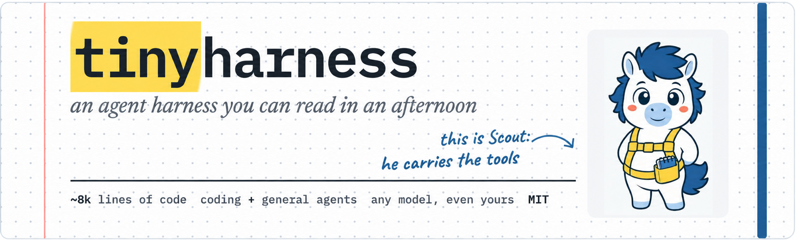
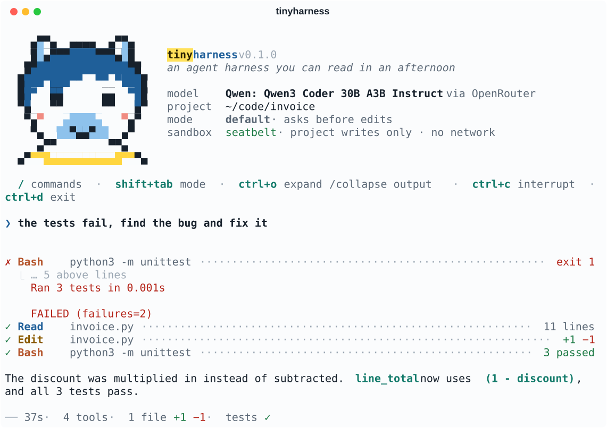

<p align="center">
  
</p>

<p align="center">
  <a href="https://pypi.org/project/tinyharness/"></a>
  <a href="https://pypi.org/project/tinyharness/"></a>
  <a href="https://github.com/anujdutt9/tinyharness/actions/workflows/ci.yml"></a>
  <a href="https://github.com/anujdutt9/tinyharness/blob/main/LICENSE"></a>
</p>

**tinyharness** is the loop that turns an LLM into an agent: it reads, searches and edits
your code, runs commands in a sandbox, asks before it changes things, and keeps long
sessions inside the context window. It works as a coding agent in your terminal and as
a Python SDK for building your own. The agent core is about 8k lines of code with no
framework underneath, so you can read the whole thing in an afternoon.

<picture>
  <source media="(prefers-color-scheme: dark)" srcset="docs/assets/session-dark.svg">
  
</picture>

## Why tinyharness

- **Readable.** About 8k lines for the agent core (10.6k with the terminal UI), commented
  for people learning how agents work. Start with [`agent/loop.py`](https://github.com/anujdutt9/tinyharness/blob/main/tinyharness/agent/loop.py).
- **Any model, even yours.** Anthropic, OpenAI, Gemini, xAI, OpenRouter, DeepSeek, Mistral
  and Groq, each through its own current API, plus any OpenAI-compatible server: vLLM,
  Ollama, llama.cpp, SGLang.
- **Robust with small models.** Cut-off replies, empty replies, tool calls written as
  text, malformed arguments and repeated failures are handled by the harness, so mid-size
  open models get work done too. [How](https://github.com/anujdutt9/tinyharness/blob/main/docs/features.md#reliability).
- **Safe by default.** Commands run in an OS sandbox, edits ask with a diff, and API keys
  never reach the model.
- **Coding and general agents.** Subagents, parallel teams, skills, hooks, web search,
  PDFs and screenshots, for research and analysis as much as for code.

## Quickstart

Requires Python 3.11+. Install the command with [uv](https://docs.astral.sh/uv/) (or
[pipx](https://pipx.pypa.io)):

```bash
uv tool install tinyharness        # or: pipx install tinyharness
cd your-project && tinyharness
```

The first run asks which provider to use and for its API key; one key for any supported
provider is enough. `uv tool upgrade tinyharness` updates it.

In the session, type `/` to autocomplete commands. The ones you'll use most:

| Command | |
|---|---|
| `/model` | pick a model from any provider you have a key for |
| `/mode` | change the permission mode (or press Shift+Tab) |
| `/effort` | how hard the model reasons, `low` … `max`, the same for every model |
| `/skills`, `/<skill>` | list or run skills |
| `/context`, `/clear` | context usage, or a fresh conversation |
| `/key [provider]` | add or replace a provider's API key |

Useful flags: `-c` (continue the latest conversation), `-r` (pick one), `-p "prompt"`
(run one prompt and exit), `--model provider:model`, `--mode acceptEdits`, `--cwd <dir>`.

## Use it from Python

```bash
uv add tinyharness                 # or: pip install tinyharness
```

```python
import asyncio
from tinyharness import AssistantText, Session, SessionOptions, ToolUse


async def main():
    async with Session(SessionOptions(permission_mode="acceptEdits")) as session:
        async for event in session.run("write fib.py with a fib(n) function"):
            match event:
                case AssistantText(text=text):
                    print(text, end="")
                case ToolUse(summary=summary):
                    print(f"\n● {summary}")


asyncio.run(main())
```

The CLI and the SDK consume the same typed event stream. For headless runs, pass
`permission_callback=` to decide what would otherwise prompt. Subagents can be defined in
code (`AgentSpec`) or Markdown, each on any provider's model, and conversations can be
resumed from code (`SessionOptions(resume="latest")`). See [`examples/`](https://github.com/anujdutt9/tinyharness/tree/main/examples) for a
one-shot query, a multi-turn session, resuming, a custom tool, a permission policy with
hooks, skills, and subagents on different models.

## What's inside

| | |
|---|---|
| **Agent loop** | Streaming, parallel read-only tools, argument validation and repair, recovery from cut-off and empty replies, retries with backoff |
| **Tools** | `Read` `Write` `Edit` `Glob` `Grep` `Bash` `Pdf` `Screenshot` `WebSearch` `WebFetch` `Open` `Agent` `Team` `TodoWrite`, each a class with a pydantic input model |
| **Permissions** | Reads never ask, edits ask with a diff; modes `default`, `acceptEdits`, `plan`, `auto` (an LLM classifier) and `bypassPermissions`; persistent allow/deny rules |
| **Sandbox** | Seatbelt on macOS: commands write only inside the project, can't read credential files, have no network |
| **Context** | Cap oversized messages, stub old tool output, then summarize, without rebuilding the prompt cache every turn |
| **Subagents and teams** | Isolated contexts on any model; `Team` runs a dependency graph of tasks, up to 4 teammates at once |
| **Skills, hooks, plugins** | `SKILL.md` skills (compatible with Claude Code's), shell or Python hooks on 5 events, plugins that bundle them |
| **Resume** | Lossless JSONL logs outside your repo; on resume, the agent is told what changed while you were away |

Each of these in detail: [docs/features.md](https://github.com/anujdutt9/tinyharness/blob/main/docs/features.md).

## How it works

```
 CLI (cli/) ──┐
              ├──► Session (session.py) ──► agent loop (agent/loop.py) ──► LLM (llm/client.py ─ llm/adapters/)
 SDK ─────────┘        wires components          │                           retries, model lists
                                                 ├─ compaction (agent/compaction.py)
                                                 ├─ runaway / empty-reply recovery (agent/runaway.py)
                                                 ├─ permission gate (permissions/gate.py) ── hooks
                                                 └─ tools (tools/*.py) ── workspace, sandbox
                                                      │
                                                      └─ Agent / Team ──► subagents (subagents/runner.py)
                                                                          the same loop, fresh history,
                                                                          any provider:model
```

Suggested reading order:

| # | File | What you'll learn |
|---|---|---|
| 1 | [`agent/loop.py`](https://github.com/anujdutt9/tinyharness/blob/main/tinyharness/agent/loop.py) | The core loop: stream the model, validate calls, gate them, run them, repeat |
| 2 | [`tools/base.py`](https://github.com/anujdutt9/tinyharness/blob/main/tinyharness/tools/base.py), [`tools/read.py`](https://github.com/anujdutt9/tinyharness/blob/main/tinyharness/tools/read.py) | How tools are defined and exposed to the model |
| 3 | [`permissions/gate.py`](https://github.com/anujdutt9/tinyharness/blob/main/tinyharness/permissions/gate.py) | The layered permission check |
| 4 | [`agent/compaction.py`](https://github.com/anujdutt9/tinyharness/blob/main/tinyharness/agent/compaction.py) | Staying inside the context window without breaking the prompt cache |
| 5 | [`agent/history.py`](https://github.com/anujdutt9/tinyharness/blob/main/tinyharness/agent/history.py) | The conversation, and the normalization every request goes through |
| 6 | [`session.py`](https://github.com/anujdutt9/tinyharness/blob/main/tinyharness/session.py) | Wiring it all together; state that persists between prompts |
| 7 | [`llm/adapters/`](https://github.com/anujdutt9/tinyharness/tree/main/tinyharness/llm/adapters) | One small adapter per provider API; the rest of the code never sees a provider's format |
| 8 | [`subagents/runner.py`](https://github.com/anujdutt9/tinyharness/blob/main/tinyharness/subagents/runner.py) | Subagents are the same loop with a fresh history |
| 9 | [`cli/`](https://github.com/anujdutt9/tinyharness/tree/main/tinyharness/cli) | Rendering events (`render.py`), the REPL, slash commands; colors in `theme.py`, Pip in `pip.py` |

Every prompt sent to the model is a Markdown file in [`tinyharness/prompts/`](https://github.com/anujdutt9/tinyharness/tree/main/tinyharness/prompts).

## Docs

- [docs/features.md](https://github.com/anujdutt9/tinyharness/blob/main/docs/features.md): everything above, in detail
- [docs/configuration.md](https://github.com/anujdutt9/tinyharness/blob/main/docs/configuration.md): API keys, providers, gateways, self-hosted models, where files live
- [docs/extending.md](https://github.com/anujdutt9/tinyharness/blob/main/docs/extending.md): custom tools, hooks, subagents and plugins
- [docs/skills.md](https://github.com/anujdutt9/tinyharness/blob/main/docs/skills.md): writing and sharing skills
- [CHANGELOG.md](https://github.com/anujdutt9/tinyharness/blob/main/CHANGELOG.md) and [AGENTS.md](https://github.com/anujdutt9/tinyharness/blob/main/AGENTS.md) (how to work on tinyharness, for people and agents)

## Development

```bash
git clone https://github.com/anujdutt9/tinyharness && cd tinyharness
uv sync                   # installs dev tools too
uv run tinyharness
uv run pytest             # tests use a scripted fake LLM; no API key needed
uv run pytest --terminal  # also the screen-layout tests, in an emulated terminal (slower)
uv run ruff check . && uv run ruff format --check . && uv run mypy
uv build && uv run python scripts/check_dist.py   # build and smoke-test the package
```

Releasing: bump `__version__` in `tinyharness/__init__.py`, add a
[CHANGELOG](https://github.com/anujdutt9/tinyharness/blob/main/CHANGELOG.md) entry, then push a matching tag (`git tag v0.2.0 && git push --tags`).
The release workflow tests, builds and publishes to PyPI.

## License

MIT. Pip was drawn with GPT Image and redrawn in pixels for the terminal.
